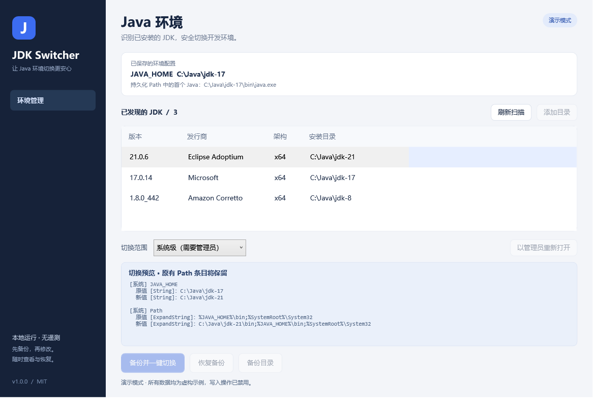

# JDK Switcher

一个注重可恢复性的 JDK 切换工具，包含独立的 Windows 与 Linux 版本。自动识别本机 JDK，预览后切换 `JAVA_HOME` 与 `Path`，每次写入前保存可恢复的原始配置。

**Windows WPF / Linux Tk 桌面界面 · Linux 命令行 · 无遥测 · MIT 开源**

- Windows：下载 `JdkSwitcher.exe`，双击运行。
- Linux：下载 `jdk-switcher-1.1.0-linux.tar.gz`，解压运行 `./jdk-switcher`；需要 Python 3.10+，图形界面另需 Tk。详见 [Linux 使用与安全说明](linux/README.md)。

Linux 使用独立的 Shell 配置后端，支持 Bash / Zsh 的当前用户环境，不会运行 Windows EXE 或修改系统 alternatives。



> 截图使用演示模式生成，路径和版本均为示例，不包含开发者或用户的本机配置。

## Windows 快速开始

支持 Windows 10 / 11，需要系统自带的 .NET Framework 4.x、WPF 和 Windows PowerShell 5.1 引擎。无需安装 PowerShell 7、JDK 之外的运行时或第三方组件。EXE 默认以普通权限运行，只有系统级切换才需要通过界面提权。

1. 下载发布的 **`JdkSwitcher.exe`**，或者解压完整项目发布包。
2. 双击 `JdkSwitcher.exe`。它是单文件桌面程序，不依赖旁边的 `src/` 或 `.ps1` 文件。
3. 选择发现的 JDK；未发现时点击“添加目录”，指定包含 `release`、`bin/java.exe` 和 `bin/javac.exe` 的根目录。
4. 查看完整的新旧配置，选择“当前用户”或“系统级”，点击“备份并一键切换”。
5. 重新打开终端和 IDE。若启动程序仍继承旧配置，注销后重新登录。

系统级修改需要管理员权限。工具会显示需要修改的系统值；如果当前账户已有用户级 `JAVA_HOME`，系统级切换也会在预览中列出并同步这个用户值，避免覆盖关系导致不一致。使用其他管理员账户的凭据提权，会作用于该管理员账户；应以目标账户本人运行。

EXE 使用 Windows 自带的 PowerShell 引擎在进程内运行嵌入的应用代码，不启动 PowerShell 子进程，不落地临时脚本，也不设置 `ExecutionPolicy`。源代码和资源均可审查，EXE 没有加壳或混淆。组织的应用控制策略仍然适用。

当前 EXE 未购买代码签名证书，下载后 Windows SmartScreen 可能显示“未知发布者”。请核对发布来源及随附的 SHA-256；哈希只能校验文件一致性，不能代替发布者签名。

从源码开发时仍可双击 `Start.cmd`，或直接运行 `src/App.ps1`。这条脚本启动路径遵循系统的 PowerShell 执行策略；受限时使用组织允许的签名或审核流程，不要修改组织策略。个人设备审核代码后，可仅在本次进程使用：

```powershell
powershell.exe -NoProfile -STA -ExecutionPolicy RemoteSigned -File .\src\App.ps1
```

这不会持久修改执行策略；EXE 启动不需要执行这条命令。

## Windows 版的安全设计

- 启动和扫描只读配置、`release` 元数据和 PE 文件头，不运行未知的 Java 程序。
- 只修改 `JAVA_HOME` 和 `Path`，不删除 JDK、不修改安装文件、不设置过时的全局 `CLASSPATH`。
- 新的 JDK `bin` 移到所选范围 Path 的最前面；保留其他原有条目及顺序，保留原有 Path 注册表类型，不使用会截断长 Path 的 `setx`。
- 用户级切换遇到系统 Java 优先级冲突或无法可靠判断的前序 Path 时停止，避免显示成功但实际无效。
- 写入前落盘并回读校验备份；写入后逐项回读校验，失败时尝试回滚本次写入。
- 进程间互斥、预览过期检测与写入期间检测。回滚遇到第三方改动会停止覆盖并报告待人工处理的条目。
- 恢复前也会备份当前配置；保留“原本不存在”和“原本为空”的区别，恢复原始变量类型和内容。

这不是跨多个注册表值的原子事务。进程被强制结束、断电或第三方恰好在检查与写入之间修改配置，仍存在竞态窗口。备份可用于恢复已部分执行的切换；无法保证任何情形下都自动回滚。详见 [安全设计](docs/SAFETY.md)。

## 备份与恢复

备份默认保存在 `%LOCALAPPDATA%\SafeJdkSwitcher\backups`，**不在项目或程序目录中**。只允许当前账户、SYSTEM 和管理员访问。备份包含原有环境变量、账户 SID 和本机标识，用于限制跨账户、跨机器误恢复；这些内容仅保存在本机，不会上传。

点击“恢复备份”选择一个备份，核对预览，再确认恢复。工具只恢复该次操作实际变更的值；如果这些值之后被其他程序修改，会拒绝覆盖。若操作被中断，仍可选择操作前的备份恢复已经写入的部分。

请勿将环境备份、真实截图、运行日志或 `.local/` 目录提交到公开仓库。备份文件不是可分享的诊断文件，也不要从不可信来源导入备份。

## 自动发现范围

- 用户与系统 `JAVA_HOME`、已有 Path 中的 JDK `bin`、当前进程的 `JAVA_HOME`。
- 常见 JavaSoft 注册表位置。
- 常见安装目录：Java、Eclipse Adoptium、Microsoft、Amazon Corretto、Zulu、BellSoft、Semeru，以及用户的 `.jdks`、Jabba、Scoop、SDKMAN 等候选目录。
- 手动添加的目录及其有限层级子目录。

不会遍历全盘，目录扫描限制为两层、每个目录最多 250 个子目录，不继续遍历目录联接。自定义安装位置请手动添加。元数据识别不是数字签名验证，也不证明某个 JDK 来源可信；工具不会下载或安装 JDK。

## 验证是否生效

在**新打开**的终端运行：

```powershell
$env:JAVA_HOME
where.exe java
where.exe javac
java -version
javac -version
```

工具检查持久化 Path 中的搜索顺序，不会执行 `java -version`。当前工作目录、应用别名、终端配置文件以及 IDE 自己固定的 JDK 均可能影响实际选择，请同时检查项目或 IDE 的设置。

## 开发与测试

PowerShell + WPF 实现业务和界面，C# 编写单文件 EXE 宿主。使用 Windows 自带的 .NET Framework C# 编译器构建，不需要 npm、Python、在线下载或 .NET SDK。

```powershell
# 单元/集成测试：内存环境存储，绝不写入真实环境变量
powershell.exe -NoProfile -File .\tests\Core.Tests.ps1

# 真实界面和自动发现的只读检查
powershell.exe -NoProfile -STA -File .\src\App.ps1 -SmokeTest

# 演示模式：虚构数据，修改操作禁用
powershell.exe -NoProfile -STA -File .\src\App.ps1 -Demo

# 只构建单文件 EXE，输出到 dist/JdkSwitcher.exe
powershell.exe -NoProfile -File .\scripts\Build-Exe.ps1

# 构建 EXE + 完整项目白名单打包、隐私检查与 SHA-256
powershell.exe -NoProfile -File .\scripts\Package.ps1
```

EXE 的 `--demo` 使用虚构数据，`--smoke-test` 只读扫描和预览，不执行切换。构建脚本自动测试编译后的真实 EXE，并检查其二进制中的本机路径、账户和机器标识。

源码中的 `.ps1` / `.psm1` 使用带 BOM 的 UTF-8，以兼容 Windows PowerShell 5.1 的中文解析。GitHub Actions 在 Windows 上运行两种 PowerShell 的核心测试与界面只读检查，并构建 EXE 与包含源码的发布包。

```text
src/           桌面界面与独立的环境管理核心
tests/         失败注入、并发保护、备份恢复等测试
scripts/       发布打包与隐私检查
docs/          安全设计及虚构数据界面截图
.github/       Windows / Ubuntu CI 与问题报告模板
linux/         Linux 桌面与命令行、独立测试、zipapp / tar.gz 打包
```

发布包只使用明确列出的文件和目录，不直接压缩整个工作目录。详见 [贡献指南](CONTRIBUTING.md) 和 [安全问题报告](SECURITY.md)。

## 许可证

[MIT](LICENSE)。欢迎通过 Issue 和 Pull Request 改进。
